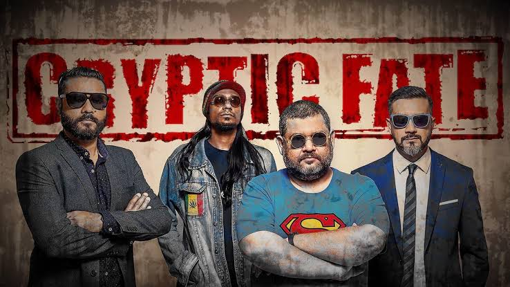

# 🎸 Cryptic Fate

[](https://github.com/BD-Band-Archive/BD-Band-Music) [](#) [](#) [](#)

<p align="center">
  
</p>

## 🌟 About the Band

> **Cryptic Fate** is one of the earliest and most revered pioneer heavy metal bands in Bangladesh, formed in Dhaka in 1993. Founded by frontman, vocalist, and bassist Shakib Chowdhury alongside drummer Farshed Mahmud and guitarist Waheedi Khan, the band later featured virtuoso guitarists Kawsar Ahmed Parthibo and Farhan Samad. Cryptic Fate initially forged Bangladesh's English heavy metal movement with their historic 1995 debut *Ends Are Forever*, before spearheading Bengali progressive heavy metal with their 2002 generational masterpiece *Sreshtho*. Renowned for thunderous dual guitar harmonies, galloping basslines, Shakib's powerful gritty baritone vocals, and profound patriotic and philosophical themes, Cryptic Fate stands as a cornerstone of Bangladeshi rock and metal history.

---

## 📑 Discography Index

1. [Ends Are Forever (1995)](#1-ends-are-forever-1995)
2. [Sreshtho (শ্রেষ্ঠ) (2002)](#2-sreshtho-2002)
3. [Danob (দানব) (2006)](#3-danob-2006)
4. [The Platform Live (2022)](#4-the-platform-live-2022)
5. [Noy Maash (নয় মাস) (2024)](#5-noy-maash-2024)
6. [Singles & Standalone Releases](#6-singles--standalone-releases)

### 💿 Mixed Albums
7. [Charpotro (2001)](#7-charpotro-2001)
8. [Projonmo (2002)](#8-projonmo-2002)
9. [Agontuk 1 (আগন্তুক ১) (2003)](#9-agontuk-1-2003)
10. [Agontuk 2 (আগন্তুক ২) (2004)](#10-agontuk-2-2004)
11. [Din Bodol (দিন বদল) (2004)](#11-din-bodol-2004)
12. [Lokayot (2004)](#12-lokayot-2004)
13. [Agontuk 3 (আগন্তুক ৩) (2005)](#13-agontuk-3-2005)
14. [Live Now (লাইভ নাও) (2007)](#14-live-now-2007)
15. [Rock 404 (2010)](#15-rock-404-2010)

---

<a id="1-ends-are-forever-1995"></a>
## 1. Ends Are Forever (1995)

- **Band:** Cryptic Fate
- **Release Year:** 1995
- **Record Label:** Soundtek (Cassette)
- **Audio Quality:** 320 kbps MP3 (Archival Master)

<p align="center">
  
</p>

### 📖 About the Album
Released on cassette tape in 1995, *Ends Are Forever* is Cryptic Fate's groundbreaking debut studio album and widely recognized as one of the very first complete English-language heavy metal albums in Bangladeshi music history. Featuring raw, blistering speed-metal and thrash-influenced riffs, the album captured the uninhibited energy of Dhaka's nascent underground scene. Standout tracks include *"Ends Are Forever"*, *"Bloodshed"*, *"Captors of Fate"*, and *"Eternal"*, which was later re-recorded in Bengali as the immortal anthem *"Protibaad"*.

### 🎵 Tracklist (One-Tap Download)

- [**1. Ends Are Forever**](https://media.githubusercontent.com/media/BD-Band-Archive/Cryptic-Fate/master/Ends%20Are%20Forever%20%281995%29/1.%20Ends%20Are%20Forever.mp3?download=true) &nbsp; [](https://media.githubusercontent.com/media/BD-Band-Archive/Cryptic-Fate/master/Ends%20Are%20Forever%20%281995%29/1.%20Ends%20Are%20Forever.mp3?download=true)
- [**2. Withered Alive**](https://media.githubusercontent.com/media/BD-Band-Archive/Cryptic-Fate/master/Ends%20Are%20Forever%20%281995%29/2.%20Withered%20Alive.mp3?download=true) &nbsp; [](https://media.githubusercontent.com/media/BD-Band-Archive/Cryptic-Fate/master/Ends%20Are%20Forever%20%281995%29/2.%20Withered%20Alive.mp3?download=true)
- [**3. Odious Zephyr**](https://media.githubusercontent.com/media/BD-Band-Archive/Cryptic-Fate/master/Ends%20Are%20Forever%20%281995%29/3.%20Odious%20Zephyr.mp3?download=true) &nbsp; [](https://media.githubusercontent.com/media/BD-Band-Archive/Cryptic-Fate/master/Ends%20Are%20Forever%20%281995%29/3.%20Odious%20Zephyr.mp3?download=true)
- [**4. Captors Of Fate**](https://media.githubusercontent.com/media/BD-Band-Archive/Cryptic-Fate/master/Ends%20Are%20Forever%20%281995%29/4.%20Captors%20Of%20Fate.mp3?download=true) &nbsp; [](https://media.githubusercontent.com/media/BD-Band-Archive/Cryptic-Fate/master/Ends%20Are%20Forever%20%281995%29/4.%20Captors%20Of%20Fate.mp3?download=true)
- [**5. An Oath Unto You**](https://media.githubusercontent.com/media/BD-Band-Archive/Cryptic-Fate/master/Ends%20Are%20Forever%20%281995%29/5.%20An%20Oath%20Unto%20You.mp3?download=true) &nbsp; [](https://media.githubusercontent.com/media/BD-Band-Archive/Cryptic-Fate/master/Ends%20Are%20Forever%20%281995%29/5.%20An%20Oath%20Unto%20You.mp3?download=true)
- [**6. Bloodshed**](https://media.githubusercontent.com/media/BD-Band-Archive/Cryptic-Fate/master/Ends%20Are%20Forever%20%281995%29/6.%20Bloodshed.mp3?download=true) &nbsp; [](https://media.githubusercontent.com/media/BD-Band-Archive/Cryptic-Fate/master/Ends%20Are%20Forever%20%281995%29/6.%20Bloodshed.mp3?download=true)
- [**7. The Sanity Deceiver**](https://media.githubusercontent.com/media/BD-Band-Archive/Cryptic-Fate/master/Ends%20Are%20Forever%20%281995%29/7.%20The%20Sanity%20Deceiver.mp3?download=true) &nbsp; [](https://media.githubusercontent.com/media/BD-Band-Archive/Cryptic-Fate/master/Ends%20Are%20Forever%20%281995%29/7.%20The%20Sanity%20Deceiver.mp3?download=true)
- [**8. Moment In Madness**](https://media.githubusercontent.com/media/BD-Band-Archive/Cryptic-Fate/master/Ends%20Are%20Forever%20%281995%29/8.%20Moment%20In%20Madness.mp3?download=true) &nbsp; [](https://media.githubusercontent.com/media/BD-Band-Archive/Cryptic-Fate/master/Ends%20Are%20Forever%20%281995%29/8.%20Moment%20In%20Madness.mp3?download=true)
- [**9. Apprehension**](https://media.githubusercontent.com/media/BD-Band-Archive/Cryptic-Fate/master/Ends%20Are%20Forever%20%281995%29/9.%20Apprehension.mp3?download=true) &nbsp; [](https://media.githubusercontent.com/media/BD-Band-Archive/Cryptic-Fate/master/Ends%20Are%20Forever%20%281995%29/9.%20Apprehension.mp3?download=true)
- [**10. Eternal (the Original Protibaad, Recorded With Sreshto)**](https://media.githubusercontent.com/media/BD-Band-Archive/Cryptic-Fate/master/Ends%20Are%20Forever%20%281995%29/10.%20Eternal%20%28the%20Original%20Protibaad%2C%20Recorded%20With%20Sreshto%29.mp3?download=true) &nbsp; [](https://media.githubusercontent.com/media/BD-Band-Archive/Cryptic-Fate/master/Ends%20Are%20Forever%20%281995%29/10.%20Eternal%20%28the%20Original%20Protibaad%2C%20Recorded%20With%20Sreshto%29.mp3?download=true)

### 🖼️ Album Artwork

| | |
| :---: | :---: |
| <br><sub><b>1. Cassette Sleeve (Front)</b></sub> | <br><sub><b>2. Cassette Sleeve (Front Alternative)</b></sub> |
| <br><sub><b>3. Cover Artwork Painting</b></sub> | <br><sub><b>4. Cassette Sleeve (Inside)</b></sub> |
| <br><sub><b>5. Original Tape (Side A)</b></sub> | <br><sub><b>6. Original Tape (Side B)</b></sub> |
| <br><sub><b>7. Official Lyrics</b></sub> | <br><sub><b>8. Concert Poster</b></sub> |
| <br><sub><b>9. Promo Poster (Color)</b></sub> | <br><sub><b>10. Promo Poster (Monochrome)</b></sub> |

---

<a id="2-sreshtho-2002"></a>
## 2. Sreshtho (শ্রেষ্ঠ) (2002)

- **Band:** Cryptic Fate
- **Release Year:** 2002
- **Record Label:** G-Series
- **Audio Quality:** Lossless FLAC (16-bit / 44.1 kHz)

<p align="center">
  
</p>

### 📖 About the Album
Released in 2002 by G-Series, *Sreshtho* ("The Best") is Cryptic Fate's defining magnum opus and one of the most revered heavy metal albums in South Asian history. Marking the band's historic transition into the Bengali language, *Sreshtho* combined soaring progressive guitar melodies, heavy driving groove rhythms, and Shakib's iconic anthemic songwriting. It features timeless Bangladeshi rock monuments including *"Protibaad"*, *"Bhoboghurey"*, *"Dhulikona"*, *"Sreshtho"*, and their immortal tribute to the 1971 liberation radio broadcasts, *"Shadhin Bangla Betar Kendro"*.

### 🎵 Tracklist (One-Tap Download)

- [**01. Dhulikona**](https://media.githubusercontent.com/media/BD-Band-Archive/Cryptic-Fate/master/Sreshtho%20%282002%29/01.%20Dhulikona.flac?download=true) &nbsp; [](https://media.githubusercontent.com/media/BD-Band-Archive/Cryptic-Fate/master/Sreshtho%20%282002%29/01.%20Dhulikona.flac?download=true)
- [**02. Bhoboghurey**](https://media.githubusercontent.com/media/BD-Band-Archive/Cryptic-Fate/master/Sreshtho%20%282002%29/02.%20Bhoboghurey.flac?download=true) &nbsp; [](https://media.githubusercontent.com/media/BD-Band-Archive/Cryptic-Fate/master/Sreshtho%20%282002%29/02.%20Bhoboghurey.flac?download=true)
- [**03. Protibaad**](https://media.githubusercontent.com/media/BD-Band-Archive/Cryptic-Fate/master/Sreshtho%20%282002%29/03.%20Protibaad.flac?download=true) &nbsp; [](https://media.githubusercontent.com/media/BD-Band-Archive/Cryptic-Fate/master/Sreshtho%20%282002%29/03.%20Protibaad.flac?download=true)
- [**04. Lobher Aagun**](https://media.githubusercontent.com/media/BD-Band-Archive/Cryptic-Fate/master/Sreshtho%20%282002%29/04.%20Lobher%20Aagun.flac?download=true) &nbsp; [](https://media.githubusercontent.com/media/BD-Band-Archive/Cryptic-Fate/master/Sreshtho%20%282002%29/04.%20Lobher%20Aagun.flac?download=true)
- [**05. Sreshtho**](https://media.githubusercontent.com/media/BD-Band-Archive/Cryptic-Fate/master/Sreshtho%20%282002%29/05.%20Sreshtho.flac?download=true) &nbsp; [](https://media.githubusercontent.com/media/BD-Band-Archive/Cryptic-Fate/master/Sreshtho%20%282002%29/05.%20Sreshtho.flac?download=true)
- [**06. Amar Sathe Aay**](https://media.githubusercontent.com/media/BD-Band-Archive/Cryptic-Fate/master/Sreshtho%20%282002%29/06.%20Amar%20Sathe%20Aay.flac?download=true) &nbsp; [](https://media.githubusercontent.com/media/BD-Band-Archive/Cryptic-Fate/master/Sreshtho%20%282002%29/06.%20Amar%20Sathe%20Aay.flac?download=true)
- [**07. Shadhin Bangla Betar Kendro**](https://media.githubusercontent.com/media/BD-Band-Archive/Cryptic-Fate/master/Sreshtho%20%282002%29/07.%20Shadhin%20Bangla%20Betar%20Kendro.flac?download=true) &nbsp; [](https://media.githubusercontent.com/media/BD-Band-Archive/Cryptic-Fate/master/Sreshtho%20%282002%29/07.%20Shadhin%20Bangla%20Betar%20Kendro.flac?download=true)
- [**08. Sesh Train**](https://media.githubusercontent.com/media/BD-Band-Archive/Cryptic-Fate/master/Sreshtho%20%282002%29/08.%20Sesh%20Train.flac?download=true) &nbsp; [](https://media.githubusercontent.com/media/BD-Band-Archive/Cryptic-Fate/master/Sreshtho%20%282002%29/08.%20Sesh%20Train.flac?download=true)
- [**09. Shet Shubhrota**](https://media.githubusercontent.com/media/BD-Band-Archive/Cryptic-Fate/master/Sreshtho%20%282002%29/09.%20Shet%20Shubhrota.flac?download=true) &nbsp; [](https://media.githubusercontent.com/media/BD-Band-Archive/Cryptic-Fate/master/Sreshtho%20%282002%29/09.%20Shet%20Shubhrota.flac?download=true)
- [**10. Dreamsayer**](https://media.githubusercontent.com/media/BD-Band-Archive/Cryptic-Fate/master/Sreshtho%20%282002%29/10.%20Dreamsayer.flac?download=true) &nbsp; [](https://media.githubusercontent.com/media/BD-Band-Archive/Cryptic-Fate/master/Sreshtho%20%282002%29/10.%20Dreamsayer.flac?download=true)
- [**11. Protibaad (Millennium Remix)**](https://media.githubusercontent.com/media/BD-Band-Archive/Cryptic-Fate/master/Sreshtho%20%282002%29/11.%20Protibaad%20%28Millennium%20Remix%29.flac?download=true) &nbsp; [](https://media.githubusercontent.com/media/BD-Band-Archive/Cryptic-Fate/master/Sreshtho%20%282002%29/11.%20Protibaad%20%28Millennium%20Remix%29.flac?download=true)
- [**12. Joyoddhoni (iTunes Bonus)**](https://media.githubusercontent.com/media/BD-Band-Archive/Cryptic-Fate/master/Sreshtho%20%282002%29/12.%20Joyoddhoni%20%28iTunes%20Bonus%29.flac?download=true) &nbsp; [](https://media.githubusercontent.com/media/BD-Band-Archive/Cryptic-Fate/master/Sreshtho%20%282002%29/12.%20Joyoddhoni%20%28iTunes%20Bonus%29.flac?download=true)

### 🖼️ Album Artwork

| | |
| :---: | :---: |
| <br><sub><b>1. Front Cover</b></sub> | <br><sub><b>2. Re-Release Cover</b></sub> |
| <br><sub><b>3. Gatefold Artwork</b></sub> | <br><sub><b>4. Tray Inlay</b></sub> |
| <br><sub><b>5. Compact Disc (CD)</b></sub> | <br><sub><b>6. Booklet</b></sub> |
| <br><sub><b>7. Back Cover</b></sub> |  |

---

<a id="3-danob-2006"></a>
## 3. Danob (দানব) (2006)

- **Band:** Cryptic Fate
- **Release Year:** 2006
- **Record Label:** G-Series
- **Audio Quality:** Lossless FLAC (16-bit / 44.1 kHz)

<p align="center">
  
</p>

### 📖 About the Album
Released in 2006 under G-Series, *Danob* ("The Monster") is Cryptic Fate's ambitious heavy metal concept album. Built around intricate progressive song structures, aggressive modern guitar tones, and allegorical lyrics confronting oppression, inner turmoil, and societal conflict, the album showcased the band at the height of their technical prowess. Immortalized by tracks such as *"Danob"*, *"Ahoban"*, *"Raag"*, *"Agniveena"*, and the epic closers *"Jatra"* and *"Ronoklanti"*.

### 🎵 Tracklist (One-Tap Download)

- [**01 Ahoban**](https://media.githubusercontent.com/media/BD-Band-Archive/Cryptic-Fate/master/Danob%20%282006%29/01%20Ahoban.flac?download=true) &nbsp; [](https://media.githubusercontent.com/media/BD-Band-Archive/Cryptic-Fate/master/Danob%20%282006%29/01%20Ahoban.flac?download=true)
- [**02 Raag**](https://media.githubusercontent.com/media/BD-Band-Archive/Cryptic-Fate/master/Danob%20%282006%29/02%20Raag.flac?download=true) &nbsp; [](https://media.githubusercontent.com/media/BD-Band-Archive/Cryptic-Fate/master/Danob%20%282006%29/02%20Raag.flac?download=true)
- [**03 Nidra**](https://media.githubusercontent.com/media/BD-Band-Archive/Cryptic-Fate/master/Danob%20%282006%29/03%20Nidra.flac?download=true) &nbsp; [](https://media.githubusercontent.com/media/BD-Band-Archive/Cryptic-Fate/master/Danob%20%282006%29/03%20Nidra.flac?download=true)
- [**04 Agniveena**](https://media.githubusercontent.com/media/BD-Band-Archive/Cryptic-Fate/master/Danob%20%282006%29/04%20Agniveena.flac?download=true) &nbsp; [](https://media.githubusercontent.com/media/BD-Band-Archive/Cryptic-Fate/master/Danob%20%282006%29/04%20Agniveena.flac?download=true)
- [**05 Anuprerona**](https://media.githubusercontent.com/media/BD-Band-Archive/Cryptic-Fate/master/Danob%20%282006%29/05%20Anuprerona.flac?download=true) &nbsp; [](https://media.githubusercontent.com/media/BD-Band-Archive/Cryptic-Fate/master/Danob%20%282006%29/05%20Anuprerona.flac?download=true)
- [**06 Daako Amar Naam**](https://media.githubusercontent.com/media/BD-Band-Archive/Cryptic-Fate/master/Danob%20%282006%29/06%20Daako%20Amar%20Naam.flac?download=true) &nbsp; [](https://media.githubusercontent.com/media/BD-Band-Archive/Cryptic-Fate/master/Danob%20%282006%29/06%20Daako%20Amar%20Naam.flac?download=true)
- [**07 Danob**](https://media.githubusercontent.com/media/BD-Band-Archive/Cryptic-Fate/master/Danob%20%282006%29/07%20Danob.flac?download=true) &nbsp; [](https://media.githubusercontent.com/media/BD-Band-Archive/Cryptic-Fate/master/Danob%20%282006%29/07%20Danob.flac?download=true)
- [**08 Aloy Badha Rater Tukro**](https://media.githubusercontent.com/media/BD-Band-Archive/Cryptic-Fate/master/Danob%20%282006%29/08%20Aloy%20Badha%20Rater%20Tukro.flac?download=true) &nbsp; [](https://media.githubusercontent.com/media/BD-Band-Archive/Cryptic-Fate/master/Danob%20%282006%29/08%20Aloy%20Badha%20Rater%20Tukro.flac?download=true)
- [**09 Asroy**](https://media.githubusercontent.com/media/BD-Band-Archive/Cryptic-Fate/master/Danob%20%282006%29/09%20Asroy.flac?download=true) &nbsp; [](https://media.githubusercontent.com/media/BD-Band-Archive/Cryptic-Fate/master/Danob%20%282006%29/09%20Asroy.flac?download=true)
- [**10 Jatra**](https://media.githubusercontent.com/media/BD-Band-Archive/Cryptic-Fate/master/Danob%20%282006%29/10%20Jatra.flac?download=true) &nbsp; [](https://media.githubusercontent.com/media/BD-Band-Archive/Cryptic-Fate/master/Danob%20%282006%29/10%20Jatra.flac?download=true)
- [**11 Ronoklanti**](https://media.githubusercontent.com/media/BD-Band-Archive/Cryptic-Fate/master/Danob%20%282006%29/11%20Ronoklanti.flac?download=true) &nbsp; [](https://media.githubusercontent.com/media/BD-Band-Archive/Cryptic-Fate/master/Danob%20%282006%29/11%20Ronoklanti.flac?download=true)

### 🖼️ Album Artwork

| | |
| :---: | :---: |
| <br><sub><b>1. Front Cover</b></sub> | <br><sub><b>2. Gatefold Artwork</b></sub> |
| <br><sub><b>3. Booklet (Page 1)</b></sub> | <br><sub><b>4. Booklet (Page 2)</b></sub> |
| <br><sub><b>5. Booklet (Page 3)</b></sub> | <br><sub><b>6. Booklet (Page 4)</b></sub> |
| <br><sub><b>7. Booklet (Page 5)</b></sub> | <br><sub><b>8. Booklet (Page 6)</b></sub> |
| <br><sub><b>9. Booklet (Page 7)</b></sub> | <br><sub><b>10. Booklet (Page 8)</b></sub> |
| <br><sub><b>11. Booklet (Page 9)</b></sub> | <br><sub><b>12. Booklet (Page 10)</b></sub> |
| <br><sub><b>13. Lyrics (Page 1)</b></sub> | <br><sub><b>14. Lyrics (Page 2)</b></sub> |
| <br><sub><b>15. Lyrics (Page 3)</b></sub> | <br><sub><b>16. Lyrics (Page 4)</b></sub> |
| <br><sub><b>17. Lyrics (Page 5)</b></sub> | <br><sub><b>18. Lyrics (Page 6)</b></sub> |
| <br><sub><b>19. Tray Inlay</b></sub> | <br><sub><b>20. Compact Disc (CD)</b></sub> |
| <br><sub><b>21. Back Cover</b></sub> |  |

---

<a id="4-the-platform-live-2022"></a>
## 4. The Platform Live (2022)

- **Band:** Cryptic Fate
- **Release Year:** 2022
- **Audio Quality:** Lossless FLAC (16-bit / 44.1 kHz)

<p align="center">
  
</p>

### 📖 About the Album
Recorded live in 2022 at The Platform studio in Dhaka, this live record captures Cryptic Fate's legendary stage energy, tight musicianship, and raw heavy metal power in pristine lossless clarity. Featuring electrifying live renditions of fan favorites spanning their three-decade career, including *"Raater Shesh"*, *"Onadorer Shontan"*, *"Jatra"*, *"Amar Shathe Aay"*, and the definitive live takes of *"Protibad"* and *"Bhoboghurey"*.

### 🎵 Tracklist (One-Tap Download)

- [**01 Raater Shesh**](https://media.githubusercontent.com/media/BD-Band-Archive/Cryptic-Fate/master/The%20Platform%20Live%20%282022%29/01%20Raater%20Shesh.flac?download=true) &nbsp; [](https://media.githubusercontent.com/media/BD-Band-Archive/Cryptic-Fate/master/The%20Platform%20Live%20%282022%29/01%20Raater%20Shesh.flac?download=true)
- [**02 Onadorer Shontan**](https://media.githubusercontent.com/media/BD-Band-Archive/Cryptic-Fate/master/The%20Platform%20Live%20%282022%29/02%20Onadorer%20Shontan.flac?download=true) &nbsp; [](https://media.githubusercontent.com/media/BD-Band-Archive/Cryptic-Fate/master/The%20Platform%20Live%20%282022%29/02%20Onadorer%20Shontan.flac?download=true)
- [**03 Jatra**](https://media.githubusercontent.com/media/BD-Band-Archive/Cryptic-Fate/master/The%20Platform%20Live%20%282022%29/03%20Jatra.flac?download=true) &nbsp; [](https://media.githubusercontent.com/media/BD-Band-Archive/Cryptic-Fate/master/The%20Platform%20Live%20%282022%29/03%20Jatra.flac?download=true)
- [**04 Amar Shathe Aay**](https://media.githubusercontent.com/media/BD-Band-Archive/Cryptic-Fate/master/The%20Platform%20Live%20%282022%29/04%20Amar%20Shathe%20Aay.flac?download=true) &nbsp; [](https://media.githubusercontent.com/media/BD-Band-Archive/Cryptic-Fate/master/The%20Platform%20Live%20%282022%29/04%20Amar%20Shathe%20Aay.flac?download=true)
- [**05 Protibad**](https://media.githubusercontent.com/media/BD-Band-Archive/Cryptic-Fate/master/The%20Platform%20Live%20%282022%29/05%20Protibad.flac?download=true) &nbsp; [](https://media.githubusercontent.com/media/BD-Band-Archive/Cryptic-Fate/master/The%20Platform%20Live%20%282022%29/05%20Protibad.flac?download=true)
- [**06 Bhoboghurey**](https://media.githubusercontent.com/media/BD-Band-Archive/Cryptic-Fate/master/The%20Platform%20Live%20%282022%29/06%20Bhoboghurey.flac?download=true) &nbsp; [](https://media.githubusercontent.com/media/BD-Band-Archive/Cryptic-Fate/master/The%20Platform%20Live%20%282022%29/06%20Bhoboghurey.flac?download=true)

---

<a id="5-noy-maash-2024"></a>
## 5. Noy Maash (নয় মাস) (2024)

- **Band:** Cryptic Fate
- **Release Year:** 2024
- **Audio Quality:** Lossless FLAC (16-bit / 44.1 kHz)

<p align="center">
  
</p>

### 📖 About the Album
Released in 2024 after years of meticulous historical research and conceptual composition, *Noy Maash* ("Nine Months") is Cryptic Fate's monumental concept album dedicated to the 1971 Bangladesh Liberation War. Across nine deeply emotive and sonically crushing tracks, the album narrates the chronological tragedy, sacrifice, bravery, and eventual victory of the nine-month war for freedom. Featuring sweeping cinematic metal orchestrations, heavy drop-tuned riffing, and visceral historical narrative across songs including *"Bhorer Opekkha"*, *"Kal Boishakhi"*, *"Mohora"*, *"Akromon"*, *"Bichchu"*, and *"Buddhihotta"*.

### 🎵 Tracklist (One-Tap Download)

- [**01. Bhorer Opekkha**](https://media.githubusercontent.com/media/BD-Band-Archive/Cryptic-Fate/master/Noy%20Maash%20%282024%29/01.%20Bhorer%20Opekkha.flac?download=true) &nbsp; [](https://media.githubusercontent.com/media/BD-Band-Archive/Cryptic-Fate/master/Noy%20Maash%20%282024%29/01.%20Bhorer%20Opekkha.flac?download=true)
- [**02. Kal Boishakhi**](https://media.githubusercontent.com/media/BD-Band-Archive/Cryptic-Fate/master/Noy%20Maash%20%282024%29/02.%20Kal%20Boishakhi.flac?download=true) &nbsp; [](https://media.githubusercontent.com/media/BD-Band-Archive/Cryptic-Fate/master/Noy%20Maash%20%282024%29/02.%20Kal%20Boishakhi.flac?download=true)
- [**03. Bidayer Gaan**](https://media.githubusercontent.com/media/BD-Band-Archive/Cryptic-Fate/master/Noy%20Maash%20%282024%29/03.%20Bidayer%20Gaan.flac?download=true) &nbsp; [](https://media.githubusercontent.com/media/BD-Band-Archive/Cryptic-Fate/master/Noy%20Maash%20%282024%29/03.%20Bidayer%20Gaan.flac?download=true)
- [**04. Mohora**](https://media.githubusercontent.com/media/BD-Band-Archive/Cryptic-Fate/master/Noy%20Maash%20%282024%29/04.%20Mohora.flac?download=true) &nbsp; [](https://media.githubusercontent.com/media/BD-Band-Archive/Cryptic-Fate/master/Noy%20Maash%20%282024%29/04.%20Mohora.flac?download=true)
- [**05. Akromon**](https://media.githubusercontent.com/media/BD-Band-Archive/Cryptic-Fate/master/Noy%20Maash%20%282024%29/05.%20Akromon.flac?download=true) &nbsp; [](https://media.githubusercontent.com/media/BD-Band-Archive/Cryptic-Fate/master/Noy%20Maash%20%282024%29/05.%20Akromon.flac?download=true)
- [**06. Bichchu**](https://media.githubusercontent.com/media/BD-Band-Archive/Cryptic-Fate/master/Noy%20Maash%20%282024%29/06.%20Bichchu.flac?download=true) &nbsp; [](https://media.githubusercontent.com/media/BD-Band-Archive/Cryptic-Fate/master/Noy%20Maash%20%282024%29/06.%20Bichchu.flac?download=true)
- [**07. Mitro**](https://media.githubusercontent.com/media/BD-Band-Archive/Cryptic-Fate/master/Noy%20Maash%20%282024%29/07.%20Mitro.flac?download=true) &nbsp; [](https://media.githubusercontent.com/media/BD-Band-Archive/Cryptic-Fate/master/Noy%20Maash%20%282024%29/07.%20Mitro.flac?download=true)
- [**08. Buddhihotta**](https://media.githubusercontent.com/media/BD-Band-Archive/Cryptic-Fate/master/Noy%20Maash%20%282024%29/08.%20Buddhihotta.flac?download=true) &nbsp; [](https://media.githubusercontent.com/media/BD-Band-Archive/Cryptic-Fate/master/Noy%20Maash%20%282024%29/08.%20Buddhihotta.flac?download=true)
- [**09. Raater Shesh**](https://media.githubusercontent.com/media/BD-Band-Archive/Cryptic-Fate/master/Noy%20Maash%20%282024%29/09.%20Raater%20Shesh.flac?download=true) &nbsp; [](https://media.githubusercontent.com/media/BD-Band-Archive/Cryptic-Fate/master/Noy%20Maash%20%282024%29/09.%20Raater%20Shesh.flac?download=true)

---

<a id="6-singles--standalone-releases"></a>
## 6. Singles & Standalone Releases

- **Band:** Cryptic Fate
- **Audio Quality:** Lossless FLAC (16-bit / 44.1 kHz)

<p align="center">
  
</p>

### 🎵 Tracklist (One-Tap Download)

- [**Cryptic Fate - Bhoboghure 2022**](https://media.githubusercontent.com/media/BD-Band-Archive/Cryptic-Fate/master/Singles/Cryptic%20Fate%20-%20Bhoboghure%202022.flac?download=true) &nbsp; [](https://media.githubusercontent.com/media/BD-Band-Archive/Cryptic-Fate/master/Singles/Cryptic%20Fate%20-%20Bhoboghure%202022.flac?download=true)
- [**Cryptic Fate - Kushiyara**](https://media.githubusercontent.com/media/BD-Band-Archive/Cryptic-Fate/master/Singles/Cryptic%20Fate%20-%20Kushiyara.flac?download=true) &nbsp; [](https://media.githubusercontent.com/media/BD-Band-Archive/Cryptic-Fate/master/Singles/Cryptic%20Fate%20-%20Kushiyara.flac?download=true)

### 🖼️ Album Artwork

| | |
| :---: | :---: |
| <br><sub><b>1. Front Cover</b></sub> |

---

<a id="7-charpotro-2001"></a>
## 7. [Charpotro (2001)](https://github.com/BD-Band-Archive/Mixed-Albums#charpotro-2001)

### 🎵 Tracklist (One-Tap Download)

- [**Cryptic Fate - Cholo Bangladesh**](https://media.githubusercontent.com/media/BD-Band-Archive/Mixed-Albums/master/Charpotro%20%282001%29/05.%20Cholo%20Bangladesh.flac?download=true) &nbsp; [](https://media.githubusercontent.com/media/BD-Band-Archive/Mixed-Albums/master/Charpotro%20%282001%29/05.%20Cholo%20Bangladesh.flac?download=true)

---

<a id="8-projonmo-2002"></a>
## 8. [Projonmo (2002)](https://github.com/BD-Band-Archive/Mixed-Albums#projonmo-2002)

### 🎵 Tracklist (One-Tap Download)

- [**Cryptic Fate - Odhikar/Cryptic Fate**](https://media.githubusercontent.com/media/BD-Band-Archive/Mixed-Albums/master/Projonmo%20%282002%29/05%20Cryptic%20Fate%20-%20Odhikar-Cryptic%20Fate.flac?download=true) &nbsp; [](https://media.githubusercontent.com/media/BD-Band-Archive/Mixed-Albums/master/Projonmo%20%282002%29/05%20Cryptic%20Fate%20-%20Odhikar-Cryptic%20Fate.flac?download=true)

---

<a id="9-agontuk-1-2003"></a>
## 9. [Agontuk 1 (আগন্তুক ১) (2003)](https://github.com/BD-Band-Archive/Mixed-Albums#4-agontuk-1-2003)

### 🎵 Tracklist (One-Tap Download)

- [**Cryptic Fate - Biday**](https://media.githubusercontent.com/media/BD-Band-Archive/Mixed-Albums/master/Agontuk%201%20%282003%29/10%20Biday.flac?download=true) &nbsp; [](https://media.githubusercontent.com/media/BD-Band-Archive/Mixed-Albums/master/Agontuk%201%20%282003%29/10%20Biday.flac?download=true)

---

<a id="10-agontuk-2-2004"></a>
## 10. [Agontuk 2 (আগন্তুক ২) (2004)](https://github.com/BD-Band-Archive/Mixed-Albums#5-agontuk-2-2004)

### 🎵 Tracklist (One-Tap Download)

- [**Cryptic Fate - Prem**](https://media.githubusercontent.com/media/BD-Band-Archive/Mixed-Albums/master/Agontuk%202%20%282004%29/07%20-%20Cryptic%20Fate%20-%20Prem.flac?download=true) &nbsp; [](https://media.githubusercontent.com/media/BD-Band-Archive/Mixed-Albums/master/Agontuk%202%20%282004%29/07%20-%20Cryptic%20Fate%20-%20Prem.flac?download=true)

---

<a id="11-din-bodol-2004"></a>
## 11. [Din Bodol (দিন বদল) (2004)](https://github.com/BD-Band-Archive/Mixed-Albums#6-din-bodol-2004)

### 🎵 Tracklist (One-Tap Download)

- [**Artcell, Black & Cryptic Fate - Ashirbad (Abc)**](https://media.githubusercontent.com/media/BD-Band-Archive/Mixed-Albums/master/Din%20Bodol%20%282004%29/01.%20Ashirbad%20%28Abc%29.flac?download=true) &nbsp; [](https://media.githubusercontent.com/media/BD-Band-Archive/Mixed-Albums/master/Din%20Bodol%20%282004%29/01.%20Ashirbad%20%28Abc%29.flac?download=true)

---

<a id="12-lokayot-2004"></a>
## 12. [Lokayot (2004)](https://github.com/BD-Band-Archive/Mixed-Albums#lokayot-2004)

### 🎵 Tracklist (One-Tap Download)

- [**Cryptic Fate - Gontobbo**](https://media.githubusercontent.com/media/BD-Band-Archive/Mixed-Albums/master/Lokayot%20%282004%29/04.%20Gontobbo.flac?download=true) &nbsp; [](https://media.githubusercontent.com/media/BD-Band-Archive/Mixed-Albums/master/Lokayot%20%282004%29/04.%20Gontobbo.flac?download=true)

---

<a id="13-agontuk-3-2005"></a>
## 13. [Agontuk 3 (আগন্তুক ৩) (2005)](https://github.com/BD-Band-Archive/Mixed-Albums#7-agontuk-3-2005)

### 🎵 Tracklist (One-Tap Download)

- [**Cryptic Fate - Onadorer Shontan**](https://media.githubusercontent.com/media/BD-Band-Archive/Mixed-Albums/master/Agontuk%203%20%282005%29/04%20Onadorer%20Shontan.flac?download=true) &nbsp; [](https://media.githubusercontent.com/media/BD-Band-Archive/Mixed-Albums/master/Agontuk%203%20%282005%29/04%20Onadorer%20Shontan.flac?download=true)

---

<a id="14-live-now-2007"></a>
## 14. [Live Now (লাইভ নাও) (2007)](https://github.com/BD-Band-Archive/Mixed-Albums#11-live-now-2007)

### 🎵 Tracklist (One-Tap Download)

- [**Cryptic Fate - Krititto**](https://media.githubusercontent.com/media/BD-Band-Archive/Mixed-Albums/master/Live%20Now%20%282007%29/04%20Krititto.flac?download=true) &nbsp; [](https://media.githubusercontent.com/media/BD-Band-Archive/Mixed-Albums/master/Live%20Now%20%282007%29/04%20Krititto.flac?download=true)

---

<a id="15-rock-404-2010"></a>
## 15. [Rock 404 (2010)](https://github.com/BD-Band-Archive/Mixed-Albums#rock-404-2010)

### 🎵 Tracklist (One-Tap Download)

- [**Cryptic Fate - Ondho**](https://media.githubusercontent.com/media/BD-Band-Archive/Mixed-Albums/master/Rock%20404%20%282010%29/01.%20Ondho%20-%20%C2%ABVarious%20Artists%C2%BB.flac?download=true) &nbsp; [](https://media.githubusercontent.com/media/BD-Band-Archive/Mixed-Albums/master/Rock%20404%20%282010%29/01.%20Ondho%20-%20%C2%ABVarious%20Artists%C2%BB.flac?download=true)

---

### 💾 Git LFS & Downloading Audio
All audio tracks in this repository are managed via **Git LFS** (Large File Storage).
- **One-Tap Direct Download:** Click either the track title or the green download button next to any song to instantly save the file to your device.
- **To clone locally with all audio files:**
  ```bash
  git lfs install
  git clone https://github.com/BD-Band-Archive/Cryptic-Fate.git
  ```

---

### 🤝 Contribution & DMCA Notice
All songs and archival materials in this repository were collected and curated from various internet sources, physical CD rips, and public community archives for cultural preservation and historical documentation.

- **Contributions:** If you have physical CD or cassette rips in lossless FLAC format, missing booklet/inlay scans, or tracklist metadata corrections, contributions and pull requests are warmly welcome!
- **DMCA / Copyright Notice:** If this repository contains your copyrighted or DMCA-protected files and you wish to have them removed, please contact:
  - **Email:** [maniruzzamanmridul@gmail.com](mailto:maniruzzamanmridul@gmail.com)
  
  Please provide the specific track, album, or file details, and the requested material will be reviewed and removed as soon as possible.

---

### 🙏 Special Thanks & Gratitude
Heartfelt gratitude to **Shohail Ibne Mahbub (XTR)** for his monumental passion and dedication in keeping Bangladeshi band music alive. Through his archival project [**Bangla CD Covers**](https://banglacdcovers.blogspot.com/), he has painstakingly collected, preserved, and scanned original physical CDs and cassette tapes, ensuring that the legacy, artwork, and history of Bangladesh's rock and band movement remain preserved for generations of music lovers.
